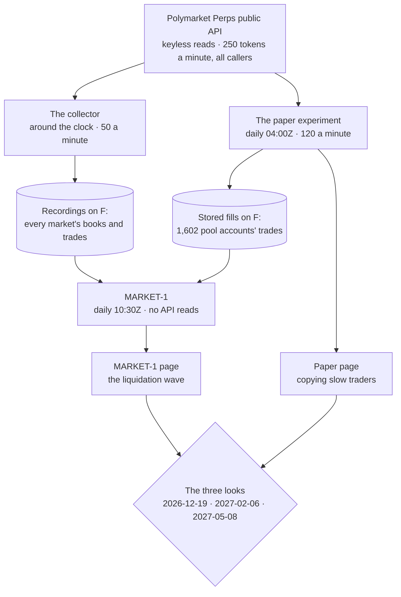
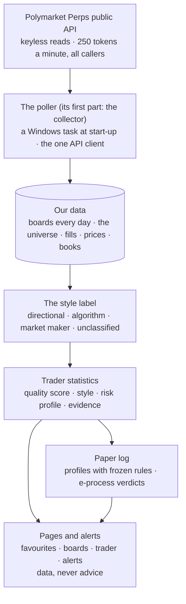
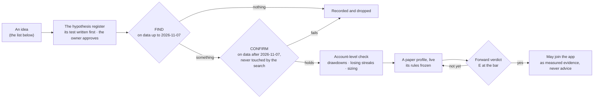

# polymarket-follow — the plan

The owner's plan page: what is planned, waiting, parked or closed, and why.
What the project is: CLAUDE.md. What is built: architecture. Why a choice
was made: decisions.

## How to read and keep this file

Every work item carries one status marker:

| Marker | Meaning |
|---|---|
| ✅ | done — in "Done lately" for two weeks, then out (its decisions entry stays) |
| 🔵 | running now |
| 🟢 | ready — its trigger has fired; next when there is room |
| ⏳ | waiting on a named trigger |
| 🅿️ | parked — kept with its trigger, not planned |
| 🧹 | a tidy-up waiting for the next touch of its file |
| ⬜ | not started, in the plan's order |
| 🟡 | partly done — what is left is named |
| ❌ | dropped or closed — the reason in decisions |

No heading carries a date: "Where it stands" carries one "Brought in step on"
line instead. After every finished task the supervisor brings this file in
step with the record; only the supervisor sets a marker.

**Two "v1"s — words used here:**
- **v1 (the app):** the first working version of the tool the owner uses —
  leaderboards with style labels, favourites, Windows alerts, trader
  statistics, the paper-follow log. It is planned after the research is
  complete ("The v1 plan" below), then built in parts on a skeleton.
- **"Research complete":** the owner's word that closes the research, after
  which the v1 plan starts (decisions 2026-11-06, three more of the owner's
  requirements). The first phase (R1–R8, R7) is finished; **research round 2**
  (the owner's "search v2") and a small data collector come first, then the
  word (decisions 2026-11-09, the road to v1). "The road to v1" below lists
  every point.
- **The style classifier v1 / v2:** versions of the rule that labels each
  account directional, algorithm, market maker, churner or unclassified (R2).
  Classifier v1 was scored blind and is used for the research; classifier v2
  fixes its two weak spots and must pass a forward blind test after
  2026-11-21 before the app ships with it (decisions 2026-11-07, the
  classifier's ruling).

## Where it stands

*Brought in step on 2026-11-13, through decisions 2026-11-13 (MARKET-1 —
the freeze).*

- **Two forward paper tests are frozen, judged at the same three looks
  (2026-12-19, 2027-02-06, 2027-05-08):**
  - **the paper experiment** (copying slow traders): frozen and running daily
    since 2026-11-12;
  - **MARKET-1** (the liquidation wave in small coins, the one lead round 2's
    data gave; decisions 2026-11-13): frozen and deployed 2026-11-13; it runs daily
    at 10:30Z.

**What runs now** (each program a Windows task; the tests decide only at
their looks):

- Founded: its own repository, database and supervisor; watch-only; perps
  first (decisions 2026-11-06).
- **The collector records** since 2026-11-10 20:59:54Z (books and trades of
  every market, the minute reads; Phase 1 below). The perps API is researched in full (R1, external-apis):
  everything v1 needs is public and keyless, with history back to launch.
- **The operating budget is 250 weighted tokens a minute, all callers
  together, evenly spaced** (decisions 2026-11-07, wave 1 closed).
- **The first research phase is finished:** all four waves are closed — 1
  (R1, R4, R5), 2 (R2 with its blind labels, R3), 3 (R6, the weekday price
  measurement, R8), 4 (R7, the pages) (decisions 2026-11-07 to 2026-11-09).
  The owner's word "research complete" opens the v1 plan. **R8: copying
  the top directional traders about 80 s late lost money and was no better
  than random trades, so v1 is planned as a watching and analysis tool**
  (decisions 2026-11-09, R8 accepted); the owner continues with a second
  research round afterwards (decisions 2026-11-09, the owner's direction after
  R8). **The
  boards' tops are mostly algorithms, market makers and inactive accounts**
  (R2). Before v1 is planned, R8 asks once, on the past, whether
  following pays and whether the leaderboard is skill or luck, by rules the
  owner amended with R3 (decisions 2026-11-06, the pre-test and waves 2–4
  approved; 2026-11-07, R3 accepted).
- **The road (the owner, 2026-11-09):** research round 2 and a small data
  collector come before v1, so v1 is built once with what round 2 finds
  (decisions 2026-11-09, the road to v1); every point is listed in "The road
  to v1" below, so that none is forgotten.
- **How a trader is judged** (decisions 2026-11-07, R3 accepted): over a fixed
  horizon against random trades, never by the trader's own exits; a verdict
  only at E ≥ 400 for one of 20 followed traders, the pooled board of all
  favourites first.

## The plan — the next steps

| | When | What | Who |
|---|---|---|---|
| ✅ | 2026-11-10 | **Phase 0 — preparation:** P0-1 the record, P0-2 the second copies, P0-3 DOCS-SWEEP, P0-4 IDEAS-REVIEW, all done ("The road to v1") | the supervisor; two subagents |
| 🔵 | since 2026-11-10 14:42Z; RECORDING since 20:59:54Z | **Phase 1 — the collector (C1):** parts 0–7 built, verified and live (part 4, the database and the nightly passes, since 2026-11-11 15:47Z after the owner's switch to a task that runs node itself; parts 5–6, health, status and backups, since 16:25Z); the backup task registered by the owner (2026-11-11); the whole collector's Final review done (COLLECTOR-REVIEW, 15 findings, 14 fixed and live since 20:22Z; decisions 2026-11-11); the poller task runs node itself at normal priority; the plan approved (`docs/reviews/collector-plan-2026-11-10.md`; decisions 2026-11-10, round 2's rules and the collector approved); the build in eight parts, recording from part 3 | a build subagent |
| ✅ | 2026-11-11 | **Phase 2 — research round 2, FIND: NOTHING PASSES.** The kit and the first measurements accepted; seven studies (entries 1, 2, 3, 4, 5, 7, 9, 10), rules frozen and reviewed before one look each, three fresh Final reviews: every result stands; no entry registered; the gate (entry 1) fails (decisions 2026-11-11, round 2's FIND results); entry 6 then ran once with the owner's filter on the owner's lift and fails too (decisions 2026-11-12, FIND-6's result); copying the traders' exits as well, an exploring check, leaves every group losing (decisions 2026-11-12, FIND-6-EXITS's result) | research subagents |
| 🔵 | since 2026-11-12 | **The way forward: a forward paper experiment** (decisions 2026-11-12, the way forward). Its design is accepted (decisions 2026-11-12, APPROACH-REVIEW accepted): slow traders (usual hold 6 h or more, at least 3 closed cycles) from the frozen pool by a rule, not a ranking; two readings of every copy (the money with the exits copied; the judgement at 24 h against random trades); data from 2026-11-07; looks 2026-12-19, 2027-02-06, 2027-05-08; keep / drop at +10 bps / too few to tell; every directional trader and the owner's favourites beside; a script once a day with a simple page showing its log (decisions 2026-11-12, the paper experiment runs daily and gets a page). Its plan is approved with its review's fixes (decisions 2026-11-12, the paper experiment's plan approved); built, reviewed three times and **frozen 2026-11-12 20:19:52Z** (decisions 2026-11-12, the freeze; tag `paper-freeze-1`); deployed by the owner 2026-11-12 20:25Z with its daily task (04:00Z); the first run, catching up from 2026-11-07, started 20:26:43Z. The exams of 11-30 and 12-19 are closed (12-19 is the first look); D1 and D2 run after the freeze | the owner deploys and registers the task |
| 🔵 | since 2026-11-13 | **MARKET-1 — a forward paper test of the liquidation wave** (decisions 2026-11-13, from "the market lead" to "MARKET-1 — the freeze"). • **The line:** when two or more pool accounts are liquidated on one side of one of 38 small coins within 60 minutes, $1,000 against the forced side 2 minutes later, at the recorded book as a taker, held 24 h. From 2026-11-11, zero API reads. • **The verdict:** keep, or drop at +50 bps, or too few to tell, at the paper experiment's three looks. • **Done:** planned and reviewed; built; two fresh reviews; the fixes and a fresh fix-check; **frozen 2026-11-13 14:29:11Z** (`market1/FROZEN.sha256`, `b9e17505…2f1d`, tag `market1-freeze-1`). • **Deployed** by the owner 2026-11-13 14:33:39Z; its daily task at 10:30Z; the first run 14:33:59–14:39:02Z ended 0 (12,095,293 recorded lines read, 0 failed; the page at `F:polymarket-followmarket1pageindex.html`) | the supervisor checks each run |
| ⬜ | early December | The v1 plan: R7's pages, the owner's rulings, V1–V7 and what round 2 has earned; the final exams run beside it on more weeks, whatever passes later is added (decisions 2026-11-09, the fast track) | a plan subagent |
| ⬜ | after the plan | The skeleton: Turborepo, the docs-size report and the decisions guard in the test run, CI | a build subagent |
| ⬜ | after the skeleton | v1, in parts, each planned first and Final-reviewed | build subagents |

## The research phase (R1–R8)

Each topic is one subagent with a written report in `docs/reviews/`, every
number from a saved script output, every fact about an API added to
external-apis, dated and sourced. **Every report states the variations it
weighed, the possibilities it found, the potential problems and how each
would be handled, and what stays unknown;** the supervisor walks the owner
through each, and nothing is planned or built until the owner says the
research is complete (decisions 2026-11-06, three more of the owner's
requirements). **Every report also has a "Beyond the brief" section and ends
with its questions for the owner, each with a recommendation** (decisions
2026-11-06, the research phase approved). **The waves** (decisions
2026-11-06, the pre-test and waves 2–4 approved): 1 — R1, R4, R5 in
parallel; 2 — R2 (with R2-LABELS, a blind re-check of its labels) and R3,
after R1; 3 — R8 and R6, after R2 and R3; 4 — R7, after R8. Every subagent
that calls the API shares one IP budget, so the waves are also its schedule;
bulk research data goes gzip-compressed to `F:\polymarket-follow-research\`.

- ✅ **R1 — The perps API in full:** every endpoint we would use — the
  leaderboard (how often it refreshes), fills and position-fills by address
  (history depth, paging, the 30-day default window), the portfolio, the PnL
  history (its parameters: a first call answered 400), instruments, funding,
  fees; each read's real weight; freshness; what a 429 looks like; the
  public WebSocket channels.
- ✅ **R2 — Trader analytics:** what to measure per trader (win rate, average
  hold, leverage, drawdown, PnL by market, trades per day), and which
  statistics stay honest at small samples. **A v1 requirement:** a style
  label on every account — algorithm or market maker versus directional
  trader — from its own fills (trades per day, holding time, both sides at
  once, positions held), proven on labelled examples (the all-time #1: 100
  fills in 64 minutes, 11 positions at once); alerts and the scoreboard
  cover directional traders by default (decisions 2026-11-06, three more of
  the owner's requirements). Also: an "underwater" flag (realized profit
  against account value — the board counts closed trades only), profit per
  volume by instrument category, competition players and reward farmers,
  and the pool's fill histories that R8 reuses (decisions 2026-11-06, the
  pre-test and waves 2–4 approved).
- ✅ **R3 — The paper-follow method:** the entry price after the alert's
  delay, fees, funding, slippage by instrument and hour, the exit; the
  after-following scoreboard and its null (polymarket-lab's F9 design:
  decisions 2026-11-06); the scoreboard's statistics valid however often the
  owner looks — an e-process, a verdict only at E ≥ 20, rules fixed before
  the data, a correction for many traders (decisions 2026-11-06, the
  pre-test and waves 2–4 approved).
- ✅ **R4 — Notifications:** Windows notifications from a background process
  (how, and how reliable — including under Task Scheduler, where a task run
  "whether the user is logged on or not" cannot show one), what an alert says;
  later phone and email.
- ✅ **R5 — Existing tools:** trackers that already follow perps or similar
  exchanges' traders, what they show, and what this project does differently.
- ✅ **R6 — Storage, retention and backup:** bytes per fill and per day at 5,
  50 and 100 followed traders (fill rates from R2); what to keep; the backup
  in its own folder on E: and F: (E: 92% full, 16 GB free, on 2026-11-06).
- ⏳ **The classifier v2's forward blind test:** the 100 holdout accounts'
  fills for 2026-11-07 to 2026-11-21, labelled blind by a fresh labeller, v2
  (frozen beforehand on non-holdout accounts) scored by the same rules; the app
  ships only with a v2 that passes (decisions 2026-11-07, the classifier's
  ruling). Trigger: 2026-11-21.

## The road to v1 — every point, so none is forgotten

*Recorded 2026-11-09 with the owner (decisions 2026-11-09, the road to v1):
the five leads after R8, the owner's thirteen points of that evening, the
supervisor's additions. Each item keeps its ID; when one is done it moves to
"Done lately" with its decisions entry.*

**From the API to the screen** (what v1 will be; the poller is the one API
client):

**How a round-2 idea earns a place in the app:**

**Method — for every item** (R1–R8's way of working, kept): **M1** a
hypothesis register — every idea and its test written and recorded before it
runs; **M2** the data after 2026-11-07 stays untouched by any search, kept to
confirm; **M3** each study a fresh subagent with its own report and Final
review, the supervisor re-computing on its own path what decides.

**Phase 0 — preparation**
- **P0-1** Record every point (this section; done 2026-11-09).
- **P0-2** ✅ A second copy, with hashes, of R3-WEEKDAY's live books on E:
  (they cannot be re-read; R3's are already copied) — done 2026-11-09 with
  R8's capture too, in `E:\backups\polymarket-follow\research-capture-2026-11-10\`.
- **P0-3 DOCS-SWEEP** ✅ (the owner's points 10 and 11; `docs/reviews/docs-sweep-2026-11-10.md`): every page of
  Polymarket's perps documentation and the specs, against what we know — the
  public routes R1's table lacks (assets, index, limit tiers, invite,
  competition widget; the POST share-card route stays off-limits), order
  types and TP/SL (another account's are private), liquidation rules,
  rewards, fee tiers, sessions, which blockchain deposits and withdrawals use.
- **P0-4 IDEAS-REVIEW** ✅ (point 12; `docs/reviews/ideas-review-2026-11-10.md`): a fresh subagent (Fable 5.1, max) reads
  every doc and report and proposes ideas ranked by impact and testability,
  first blind, then merged with this list and DOCS-SWEEP's findings.

**Phase 1 — the collector**
- **C1** (points 1 and 2, the "tiny collector"): a Windows task, not a
  subagent (a restart of the Claude app stops subagents), that keeps what can
  never be re-read — every board's top 1,000 each day (16 boards), best
  prices and books on a schedule — and **the universe**: every account ever
  seen on a board, kept and refreshed after it drops off; backups on E: and
  F: (decisions 2026-11-08, R6 accepted).

**Phase 2 — research round 2** (each through the register, M1–M3)
- **H1** Weak persistence: B2's confirm pair, weeks 9–12, rebuilt after
  2026-11-30 (lead 1; decisions 2026-11-09, R8 accepted, (3)) — the dated
  check **D2**.
- **H2** Long track records: traders judged on months of the universe, not
  one month's top (lead 2, point 2).
- **H3** An honest quality score (point 6): shrinkage, the probabilistic and
  deflated Sharpe ratio, the minimum track-record length, profit factor,
  expectancy, consistency (share of positive weeks), drawdown measures;
  tested on whether it predicts the next weeks.
- **H4** Trading style as a filter (point 4): scalp, intraday, swing,
  position — does following slower traders survive the delay and costs?
- **H5** A risk-discipline profile (point 3): win against loss size, how far
  price went against a position before its close (and in its favour),
  stop-like habits, liquidations — from fills and the 1 s marks (another
  trader's TP/SL orders are private).
- **H6** Which trades: size unusual for the trader, adding to a winner
  (lead 3).
- **H7** Consensus: several directional traders entering one instrument in
  one direction within a short window (lead 3, point 8).
- **H8** Why #47's entries could not be copied at a profit while it made
  $109,386 — exits, sizing, patience (lead 4).
- **H9** Market context: multi-day horizons, funding, open interest,
  liquidation waves, sessions, order books (lead 5, an addition).
- **H10** Big players (point 7): algorithms, market makers and whales —
  their net positioning over hours as a signal; how the liquidity rewards
  shape them; an "algorithm" label is not "no skill".
- **H11** AI, honestly (point 9): an AI's rating of entries, made without
  outcomes, tested in its own paper profile; a confidence figure from an AI
  is never shown as fact (Iron Rule 6 — changing it is the owner's call).
- **H12** The account-level check for anything that passes: drawdowns,
  losing streaks, sizing (an addition; prop platforms set drawdown limits).
- **H13** On-chain (point 11): deposits and withdrawals, the same address
  elsewhere (a longer record) — after DOCS-SWEEP names the chain; public,
  pseudonymous data only, no identities.
- **D1** The style classifier v2's forward blind test, after 2026-11-21
  (decisions 2026-11-07, the classifier's ruling).

**For the v1 plan** (recorded now, planned after "research complete")
- **V1** Favourites from zero, added over time; a per-trader alert switch on
  the trader's page — a favourite without alerts is watched only (point 1).
- **V2** The universe on its own page beside the boards (point 2).
- **V3** Paper-log profiles chosen in the header, each with rules frozen at
  creation; their number counts in the statistics (point 13).
- **V4** Charts to compare traders — profit, win rate, style (point 5; the
  library is the plan's choice, d3 or one built on it).
- **V5** The pages designed with the owner's "Claude design" skill, from
  R7's wireframes (point 14).
- **V6** An AI's plain-words description of a trader from our measured
  statistics, cheap per trader (point 9; optional).
- **V7** R7's pages and the owner's twelve rulings (decisions 2026-11-09, R7
  accepted).
- **V8** Before more coding (the v1 skeleton), align `docs/claude-code-rules.md`
  with the important parts of polymarket-lab's code-rules
  (`E:\coding\polymarket-lab\docs\claude-code-rules.md`, read only): controllers,
  models, DTOs, the API client, components, comments — the same rules for the
  same things in both projects, not a copy of everything (the owner,
  2026-11-10).

## Later — the backlog

- ⏳ **MARKET-1's second arm**: the variants parked for a later arm, as their
  own frozen arm with their own START. Zero API reads; MARKET-1's road
  (decisions 2026-11-13, the owner's rulings after MARKET-1's deploy (1)).
  Trigger: MARKET-1 stable for a week (about 2026-11-20); the supervisor
  proposes it.
- ⏳ **Waves live in v1, as information** (labelled "under test", never
  advice). Open: how to see liquidations soon enough inside the budget
  (decisions 2026-11-13, the owner's rulings after MARKET-1's deploy (2)).
  Trigger: the v1 plan.
- ⏳ **The recordings' second copy**: the owner provides the space within
  one to two months; the supervisor sets up the copy (same entry, (3)).
- ⏳ **The backup task's trigger from UTC**: it takes effect when the
  collector's tasks are next registered. Do it before summer time starts
  on 2027-03-28.
- ⏳ **A later batch, on new weeks** (decisions 2026-11-11, round 2's FIND
  results): the candidates "after a jump" (FIND-4), the counter-move before
  agreement (FIND-9) and the top accounts' long holds (FIND-2); the gate
  reopened after six more months; the kit's fixes from the Final reviews
  first. Trigger: the owner's word.
- ⏳ **The owner's own execution venue and costs** — where the owner acts on what the tool shows and what a round trip costs there (the owner will explain and show; decisions 2026-11-10, round 2's rules and the collector approved). Until then every table uses Polymarket Perps' measured taker costs. Trigger: the owner's word.
- 🅿️ **Prediction-market traders** (the Polymarket Data API; polymarket-lab's
  external-apis holds verified facts about it, readable as a template; its
  daily top-50 leaderboard since late August 2026 is worth a one-time
  read-only export, since no API can backfill it). Trigger: v1 running well,
  and the owner's word.
- ⏳ **R4's owner test sheet** (`workers/R4-NOTIFY/OWNER-TEST-SHEET.md` in the
  supervisor folder: banners, the click, lock screen, Do Not Disturb, the Task
  Scheduler test, the own app name). Trigger: the notifier's build; the
  supervisor guides the owner through it (decisions 2026-11-07, wave 1
  closed).
- 🅿️ **Alerts on other devices and by email** — first ntfy with a long random
  topic, plus a dead-man's switch that alarms from outside when the PC is
  silent (R4 §9). Trigger: Windows alerts working.
- 🅿️ **A manual "same person" note** for addresses the owner links (R5).
  Trigger: v1 running, and the owner's word.
- 🅿️ **Paid data** — a higher rate tier or a data vendor. Trigger: research
  shows the free API cannot do something v1 needs; the owner decides.
- 🅿️ **Thinning order books before price jumps, as an alert type**
  (polymarket-lab's `docs/reviews/data-hunt-2026-11-04.md`, Q3). Trigger: v1
  running well, and the owner's word.
- 🅿️ **How fast the leaderboard turns over** (polymarket-lab's master-plan,
  "What the leaderboard is actually for", use 3). Trigger: v1 storing
  leaderboard snapshots.

## Done lately

- ✅ 11-13 **MARKET-1 built, reviewed and frozen:**
  - planned (MARKET-PLAN) and the plan reviewed;
  - built to its rules; the old weeks reproduced (153 entries, +309.7 ±
    67.7 bps a day on marks) and the bridge rehearsal through the forward
    readers equal;
  - a fresh rules review and a fresh code review (both "after these
    fixes"), the owner's ruling, the fixes, a fresh fix-check, M0's wording;
  - frozen at 64 files, with 240 of 249 deliberate breaks caught (decisions
    2026-11-13, MARKET-1 — the freeze).
- ✅ 11-13 **MARKET-FIND — the market lead:** liquidation waves in small coins
  (two or more pool accounts forced out on one side within 60 minutes) were
  followed by about +300 bps in 24 h on the old weeks; nothing outside a
  wave; confirmed by the supervisor's own code (decisions 2026-11-13, the
  market lead).

- ✅ 11-12 **APPROACH-REVIEW — the paper experiment's design:** the outside
  evidence (copying has paid only with slow information and small costs);
  slow traders by a rule, two readings of every copy, three looks to May;
  the owner accepted all seven recommendations (decisions 2026-11-12,
  APPROACH-REVIEW accepted).
- ✅ 11-12 **FIND-6-EXITS — FIND-6's copies with the trader's exits copied
  (exploring, decides nothing):** every group still loses; copying every
  candidate lost 16 bps a copy against 13 held a day; the owner's filter's top
  fifth 24 against 53, its rest 14; the traders leave within about 47 minutes
  and a round trip's cost eats the move (decisions 2026-11-12, FIND-6-EXITS's
  result).
- ✅ 11-12 **FIND-6 — seven ways of ranking traders, the owner's filter
  among them:** none picks traders whose next weeks a follower could use; the
  filter's top fifth lost 53 bps a copy against the rest's 3, within chance;
  the trader's own exits were never copied (decisions 2026-11-12, FIND-6's
  result).
- ✅ 11-11 **Research round 2, FIND — nothing passes:** traders' results do
  not persist from week to week (the gate); slow traders, kinds of entries,
  algorithms' large orders, agreement, the first minute and R8's US-open
  cell show nothing a follower could use; R8's 50 other than #47 banked a
  loss together in the weeks R8 followed them (18 of the 49 above zero, 28
  below); three fresh Final reviews confirm every result
  (decisions 2026-11-11, round 2's FIND results).
- ✅ 11-11 **RESEARCH-KIT — the panel, the kit, the first measurements:**
  one-minute prices of 91 markets to the cut, equal to R8's capture; one kit
  every round-2 study imports, proven on R8 (−16.36 by the minute against
  −16.60; an independent pricer agrees); for a taker the 1- and 6-hour
  cells of the main markets cannot pay their costs, so the d-based entries
  are judged at 24 h; the owner ruled all six questions (decisions
  2026-11-11, RESEARCH-KIT accepted).
- ✅ 11-09 **R7 — the pages:** eight pages of a watching and analysis tool
  (Watch first, Boards, Trader, Alerts, Paper log, Status, Method, Settings);
  the pages read only the database; ports 3300 and 4300; the owner's twelve
  rulings (decisions 2026-11-09, R7 accepted).
- ✅ 11-09 **R8 — does following pay; skill or luck:** FAILS — following the
  top 50 directional traders about 80 s late lost 16.6 bps an entry and was
  no better than random trades; no confirmed skill (B2's confirmation needs
  weeks 9–12); v1 becomes a watching and analysis tool (decisions 2026-11-09,
  R8 accepted).
- ✅ 11-09 **R3-WEEKDAY — the follower's price on a weekday:** two hours in
  US trading hours beside R3's Saturday table; costs higher on the weekday
  morning for majors, commodities and indices; R8 prices with the weekday
  table in US hours and the Saturday table otherwise (decisions 2026-11-09,
  R8's price table chosen).
- ✅ 11-08 **R6 — storage and backup:** small data for real traders (~0.17 GB a year for 20), a ceiling of 79 GB a year at 50 machine-speed favourites; backups on E: and F:, never D: (decisions 2026-11-08, R6 accepted).
- ✅ 11-08 **R2 — the style label and trader statistics** (with R2-LABELS,
  the blind labels): v1 scored blind (trap 2 of 23, both anchors caught), v2
  frozen for the forward test, the population of the boards' tops, the
  display defaults (decisions 2026-11-07, 2026-11-08).
- ✅ 11-07 **R3 — the paper-follow method:** the mark-plus-cost price, the
  fixed-horizon vote, e-Bonferroni and the pooled board; Final-reviewed by a
  fresh subagent; seven proposals approved (decisions 2026-11-07, R3
  accepted).
- ✅ 11-07 **Wave 1 — R1 (the API), R4 (notifications), R5 (existing
  tools):** verified on the supervisor's path, Final-reviewed (34 marked
  corrections); the operating budget set at 250 tokens a minute; the v1
  defaults approved (decisions 2026-11-07, wave 1 closed).
- ✅ 11-06 **The supervisor's first session:** the founding docs checked
  against the saved spec, the research phase proposed and approved
  (decisions 2026-11-06, the research phase approved).
- ✅ 11-06 **Founded:** the repository, the supervisor folder and the founding
  docs (decisions 2026-11-06, polymarket-follow founded).
